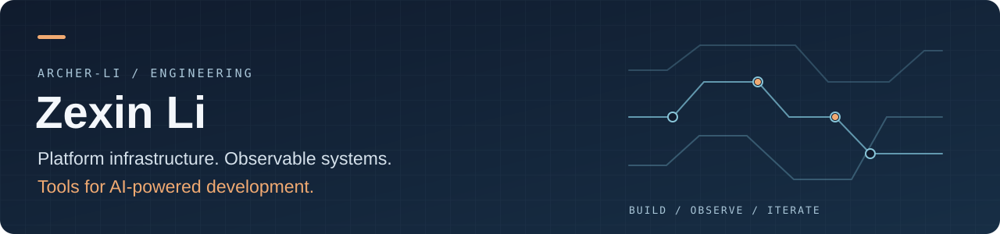

  

**Based in New York. Into systems and AI tools.**

I enjoy building useful tools and exploring streaming APIs, observable systems, and AI workflows.

[LinkedIn](https://www.linkedin.com/in/zexin-archer-li/) · [Public repositories](https://github.com/Archer-Li?tab=repositories)

## Interests

- **Platform infrastructure** — Nginx/OpenResty proxies, streaming APIs, reusable middleware, and secure service access.
- **Observability** — OpenTelemetry, Kubernetes, Helm, telemetry pipelines, and tools for investigating production issues.
- **AI developer tooling** — MCP integrations, agent workflows, and test and evaluation harnesses.
- **Full-stack delivery** — Connecting backend services, authentication, and web interfaces into working products.

## Tools & technologies

| Area | Tools I've worked with |
| :--- | :--- |
| Platform & telemetry | Nginx, OpenResty, OpenTelemetry, Kubernetes, Helm, Grafana |
| Languages | Lua, Python, Java, Ruby, JavaScript / TypeScript, SQL |
| Applications & data | Vue, React, Django, PostgreSQL, MySQL, Redis |
| Engineering workflows | MCP, Playwright, performance testing, agent evaluation |

## A learning loop between humans and AI

AI challenges our assumptions; our feedback improves how AI works. Build, test, learn, repeat—with more room for creativity and meaningful work.
